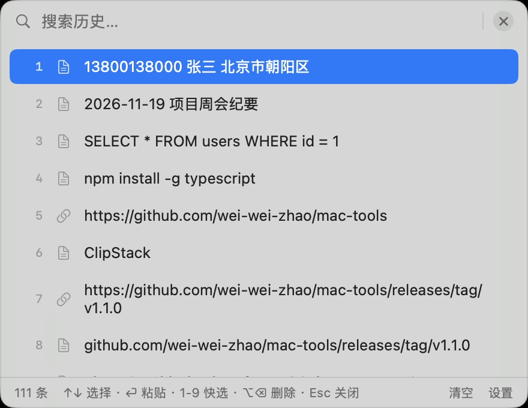

# mac-tools

macOS 上两个纯本地小工具，不联网、不登录、不上传任何数据。

[](https://github.com/wei-wei-zhao/mac-tools/releases)
[](LICENSE)
[]()

## 下载

前往 **[Releases](https://github.com/wei-wei-zhao/mac-tools/releases)** 下载安装包。

| 工具 | 安装包 | 适用机型 |
|---|---|---|
| **ClipStack** — 剪贴板历史 | `ClipStack-1.1.0.zip` | Intel + Apple Silicon 通用 |
| **WiFiDrop** — 局域网互传 | `WiFiDrop-1.4.5.zip` | Apple Silicon |

> 首次打开如遇「无法验证开发者」，请**右键点应用 → 选「打开」→ 再点「打开」**。这是 macOS 对未公证应用的保护机制。

---

## ClipStack

自研 macOS 剪贴板历史管理器，替代 [Maccy](https://github.com/p0deje/Maccy)。单文件 Swift 实现，不需要 Xcode 工程。



### 快捷键

| 操作 | 快捷键 |
|---|---|
| 粘贴最近一条 | `⌘V`（系统原生，不做拦截） |
| 唤起 / 关闭历史面板 | `⇧⌘C` |
| 上下选择 | `↑` `↓` |
| 选中并粘贴到原位置 | `⏎` |
| 数字快选第 N 条 | `1`–`9` |
| 删除选中条目 | `⌥⌫` |
| **进入多选** | `⌘` 点击条目 |
| **批量粘贴** | 多选后按 `⏎`（按列表顺序换行合并） |
| **批量删除** | 多选后按 `⌥⌫` |
| 退出多选 | `Esc` |
| 关闭面板 | `⇧⌘C` / 右上角 ✕ |

### 设计要点

1. 每 0.3 秒轮询 `NSPasteboard.changeCount`，文本内容全部入库
2. `⌘V` 走系统原生通道，**永远是最新一条**，历史顺序不受任何操作影响
3. 选中历史粘贴时，通过辅助功能 API（`AXSelectedText`）直接写入目标输入框，**完全不经过剪贴板**
4. 数据纯本地：`~/Library/Application Support/ClipStack/history.json`（权限 600）
5. 面板固定显示在外接屏右上角，不遮挡主屏办公区
6. **历史默认无限保留**（可在设置里改为 100/200/500/1000 条或暂停记录）
7. **支持多选**：`⌘` 点击勾选多条，`⏎` 按顺序合并粘贴，`⌥⌫` 批量删除

### 构建

```bash
cd ClipStack
swiftc -O -swift-version 5 -target arm64-apple-macosx14.0 -o ClipStack ClipStack.swift
```

打包 `.app` 和签名要求见 [ClipStack/README.md](ClipStack/README.md)。

### 权限说明

需要「辅助功能」权限才能往其他 App 的输入框写文字：

`系统设置 → 隐私与安全性 → 辅助功能 → 勾选 ClipStack`

⚠️ 签名必须使用**固定证书**，不能用 ad-hoc，否则每次重新编译授权都会失效。

---

## WiFiDrop

手机浏览器扫码打开网页，和 Mac 双向传文件、同步剪贴板。**手机端零安装、零登录、纯局域网通信。**

| 功能 | 说明 |
|---|---|
| 📤 传到 Mac | 点选或多选文件，带进度条 |
| 📥 从 Mac 取 | 文件浏览 + 图片缩略图，可逐层浏览目录 |
| 📋 文字 | 剪贴板双向同步 |

启动方式：双击 `启动.command`，终端里会显示二维码，手机扫一下即可。

详见 [WiFiDrop/README.md](WiFiDrop/README.md)。

### 构建

```bash
cd WiFiDrop
pip install pyinstaller flask
pyinstaller wifidrop.spec
```

---

## 环境要求

- **macOS 14.0+**（ClipStack 面板使用 SwiftUI 的 `onChange` 双参数签名）
- **Python 3.13**（WiFiDrop，仅构建时需要）
- **Swift 6.3**（Xcode Command Line Tools 即可）

## 隐私

两个工具都**只在本机运行，不连接任何服务器，不收集任何数据**。

⚠️ 剪贴板历史为明文存储，可能包含密码、证件号等敏感信息。公用设备请勿长期开启。

## 许可证

[MIT](LICENSE)

---

如果这个小工具帮你省下了一点时间，点个 ⭐️ 会让更多人看到它。
